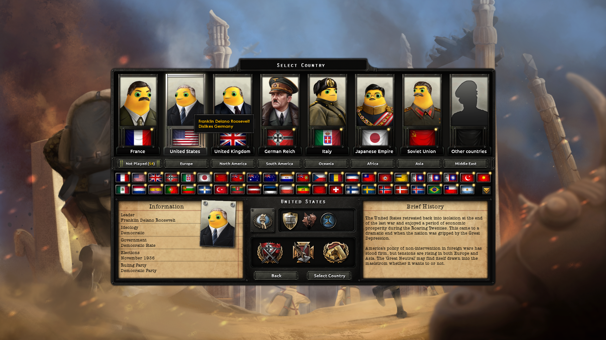

# XenoAmess 的 Hearts of Iron IV 模组开发

公开仓库：<https://github.com/XenoAmess/xenoamess_hoi4_dev>。

面向 HOI4 的多模组工作区。每个独立产品放在自己的 `mod_<name>/` 下，独立保存素材、源码、清单、工具、文档和构建入口。游戏、Steam 和启动器的实际操作采用**截图/OCR＋键鼠**；无 MCP、游戏注入或后端服务。

```text
xenoamess_hoi4_dev/
├── AGENTS.md
├── tools/                     # 共享 Python：机器身份、桌面 OCR/键鼠等
├── docs/                      # 共享知识与存储规则
├── workshop/products.json     # 产品身份；未发布 ID 保持 null
└── mod_nailong/
    ├── AGENTS.md
    ├── README.md
    ├── assets/                # 用户参考图、完整提示词、原始高清 PNG 及审图派生图
    ├── data/                  # 原图清点、生成来源与审图记录
    ├── mod/                   # 游戏 payload 源（生成 DDS 不入库）
    ├── tools/                 # 清点、续跑、导入、构建
    └── docs/                  # 本产品验收、边界和进度
```

首个产品是 [钢奶龙心](mod_nailong/README.md)：逐原头像融合用户提供的奶龙角色，保留衣物、神态和动作。1.19.3库存的5481张人物素材均已通过审查，[最后12张接收记录](mod_nailong/data/high12-owner-intake-20261105.json)保存逐项核对结果。发布前核对本机已安装的1.19.4.1，重新清点发现此前库存之外的3个人物来源；当前为 **5481/5484** 人物素材通过，另有4个非人物例外保留原图。此清点不证明这3个来源何时加入游戏。素材完成与游戏实机、公开安装包更新分别记录。

《钢奶龙心》[GitHub 1.0更新](https://github.com/XenoAmess/xenoamess_hoi4_dev/releases/tag/nailong-v1.0-20261105)与[原创意工坊条目](https://steamcommunity.com/sharedfiles/filedetails/?id=3830400579)均已于北京时间2026-11-07更新，含5579个贴图绑定，比上一安装包增加262个。GitHub公开资产已完整下载核SHA；Steam实际订阅缓存的全部贴图和缩略图也与构建一致，descriptor仅有客户端序列化及远端ID差异。完整正式构建仍有748条既有未解析引用待处理。游戏贴图逐项对齐原版来源分辨率，完整高清 PNG 原始字节另行归档。[本次发布与验收记录](mod_nailong/data/publication/1.0-update-20261105/published-20261107.json)保留真实范围与待办。

领口修正版已在实际选国页面和罗斯福信息卡显示，构建、机器和验收范围见[preview-007 实机回执](mod_nailong/docs/collar-preview-007-runtime.json)；该历史实机记录只覆盖所示位置，不证明新增素材的游戏内显示。内置图片工具的1/4/8路实测与吞吐边界见[并发记录](mod_nailong/docs/builtin-image-concurrency.md)。



```text
python -m pip install -r requirements.txt
set HOI4_GAME_ROOT=<实际 HOI4 安装目录>
python mod_nailong/tools/catalog.py scan
python mod_nailong/tools/catalog.py prepare --limit 16
python mod_nailong/tools/portraits.py coverage
python mod_nailong/tools/build_release.py --preview --check
python mod_nailong/tools/build_release.py --preview --output dist/naiwa-preview-001
```

`set` 是 Windows cmd 的环境变量命令。也可对 `catalog.py scan` 传 `--game-root`。开发构建无需启动 Steam，也不要求 Steam 在线。图像生成使用内置 imagegen skill，不要求 API key；仓库 Python 工具不会偷偷换用付费 API。

永久协作规则见 [AGENTS.md](AGENTS.md)：每次任务默认提交并推送；Steam 仅在下载/上传等必要阶段在线，完成或中止后立即恢复离线。GitHub 推送和图片生成无需改变 Steam 状态。

2026-11-05更新的[离线构建已完成逐文件与母版派生像素验证](mod_nailong/data/publication/1.0-update-20261105/build.json)。2026-11-07本包已在1.19.4.1.99a5实机抽查七国选国卡、英国政治界面及新增的Alan Brooke/John Vereker陆军顾问小卡；这次抽查使用本地发布副本。Steam新下载订阅版的启动验证尚未完成：客户端要求先退出运行中的《文明VI》才能离线，当前保留该游戏，等待用户处理，不将本地实机冒充订阅版验收。
