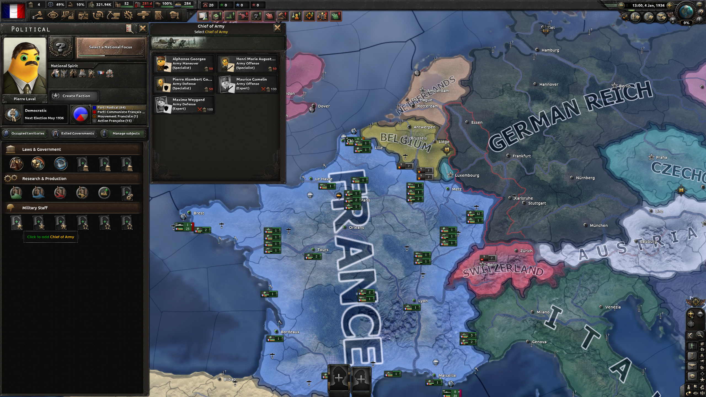
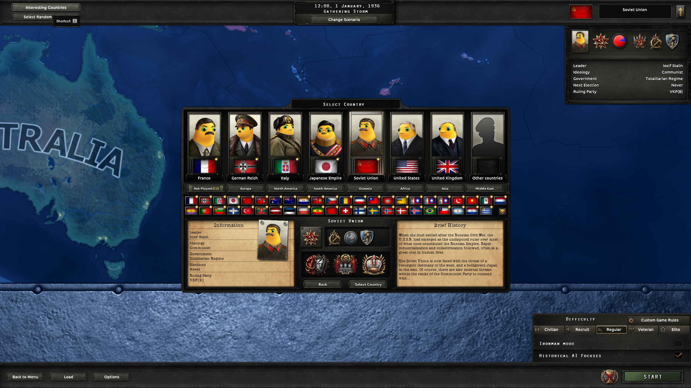

# 钢奶龙心 / Hearts of Nailong

把《钢铁雄心 IV》的人物本体替换为圆滚滚的黄色奶龙，保留每个人原有的服装、发型、胡须、配饰、姿态与取景。

当前公开版本 **1.0**，适配 HOI4 **1.19.x**。GitHub与原创意工坊已于北京时间2026-11-07更新，均包含 **5579 个贴图绑定**，比上一安装包增加262个。1.19.3库存的5481张人物素材均已完成，[最后12张接收记录](data/high12-owner-intake-20261105.json)保存来源、原始 PNG、请求与审图资格核对。该次发布前重新清点本机已安装的1.19.4.1游戏，发现此前库存之外的3个人物来源；当时为 **5481/5484** 人物素材通过，另有4个非人物例外保留原图。此清点不证明这3个来源何时加入游戏。该次完整正式构建仍有748条既有未解析引用待处理。

本机现为 **1.20.0.0 / Build 26733403**。本次15个新出现的原始SHA（4张大头像、11张小卡）已逐张生成及审查通过，实际待处理图片0；高清原件、返修前后版本与完整请求均保留。当前库存5,888个唯一来源包含5个非人物原图例外，440条未解析引用继续单列；1.20完整原尺寸包及实际发布排除审计已通过并完成本地部署；已实际抽查七国主卡、罗马尼亚新Tatarescu及菲律宾Quezon选国头像并正常退出，见[有限实机回执](data/update-plans/20261121-limited-live-qa.json)，见[本轮计划](docs/hoi4-1.20.0-portrait-plan.md)。

此前1.19.5新增395个来源的处理仍保留为历史完成结果：394个AI头像通过、1个BACK SOON原图例外，三个更早人物缺口亦已补齐。其5,810贴图工作构建的原尺寸与实包排除审计通过，但仅完成1.19.5主菜单启动及正常退出，不能代替1.20头像实机；见[旧构建回执](data/update-plans/20261119-full-native-build.json)及[旧任务表](docs/hoi4-1.19.5-portrait-plan.md)。当前工作库存尚未替换下方的旧公开安装包。

2026-11-25联网检查：Steam仍提供默认公开版 **1.20.0.0 / Build 26733403**，本轮未出现更高版本下载；官方验证 **58,581个文件全部成功**。随后完整重扫 **6,117资源／5,888独立来源**，与上轮路径、原始SHA和引用逐项相同，**新增0、原图变更0、实际待处理0**；5个非人物原图例外和440条未解析引用继续分别保留。Steam已从新原图人工确认恢复离线，未启动游戏或重发图片，见[本轮检查回执](data/update-plans/20261125-update-check.json)。

[Steam 创意工坊订阅](https://steamcommunity.com/sharedfiles/filedetails/?id=3830400579) · [GitHub 1.0 安装包](https://github.com/XenoAmess/xenoamess_hoi4_dev/releases/tag/nailong-v1.0-20261105)

2026-11-20此前续验因Steam加载页未获离线证明而未启动HOI4，已正常退出并交还桌面，见[历史门禁回执](data/update-plans/20261120-steam-recovery-gate.json)。之后客户端由文明VI线程恢复；本轮准备启动时发现新的1.20引擎，因此先重做清点与构建。后续启动仍须本项目自己的新鲜原图／OCR离线证明。

法国、英国、美国已进行实际界面抽查，法国推进到 1936 年 1 月 4 日。实测版本为 1.19.3.0，范围、截图和机器证据见[实机验收记录](docs/native-resolution-live-qa-2026-10-30.md)。这不代表所有人物、国家、事件和 DLC 组合均已逐项实机遍历。

游戏贴图逐项采用其原版来源的分辨率。完整高清生成 PNG 原件按原始字节保存在 [`assets/generated_fullsize/`](assets/generated_fullsize/)，用于素材追溯；其中也包含历史版本和未通过审图的结果，不能把素材归档数量当作当前合格数量。[高清索引](data/fullsize-files.json)记录 SHA、尺寸和来源关联。

请将游戏与现实区分开来，尊重不同国籍、族群与背景的玩家，反对歧视，珍惜和平。完整中英双语介绍见 [Workshop 文案](docs/workshop-description.bbcode)。

从 GitHub Release 下载 `gangnailongxin.zip`，解压到 HOI4 用户目录的 `mod` 下，并创建外层 `.mod` 文件指向该目录；也可在创意工坊订阅。与替换相同头像的其他模组可能冲突，建议先单独启用。

开发工具、完整提示词与审图记录保存在仓库中；只有构建器生成的 staging 内容进入游戏包。内部 manifest 如实保存当前覆盖和验收状态。

生产、重试、纯 OCR/键鼠与素材归档规则见 [AGENTS.md](AGENTS.md)。

2026-11-18 起，中国共产党及其相关势力的图片允许制作和归档，但从后续 mod 安装包中排除，其素材缺口不阻塞发布；范围不扩展到外国共产党势力。构建过滤和 Steam／GitHub 上传前的额外审计见[发布排除规则](docs/release-exclusions.md)。这一规则尚不代表旧公开安装包已经更新。

2026-11-05更新的[离线构建已完成逐文件与母版派生像素验证](data/publication/1.0-update-20261105/build.json)。2026-11-07已完成两平台发布、GitHub完整资产下载核SHA、Steam真实订阅缓存贴图核对，以及实际订阅版的七国选国卡、英国政治界面和新增Alan Brooke/John Vereker顾问小卡抽查。测试已正常退出，Steam保持离线。仅为所示位置的有限实机抽查；本机启动器报null后，经资源管理器启动同SHA游戏程序完成测试。实际证据、descriptor差异和启动边界见[最终回执](data/publication/1.0-update-20261105/completed-20261107.json)。
