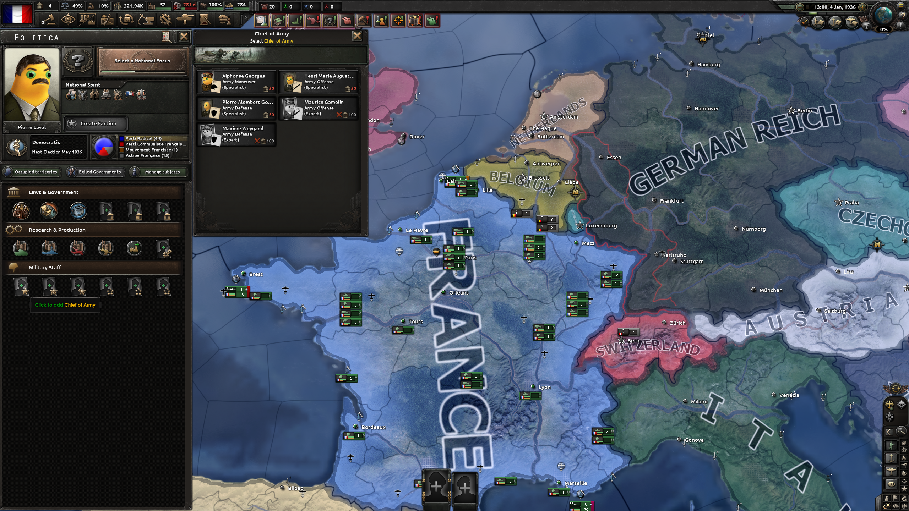
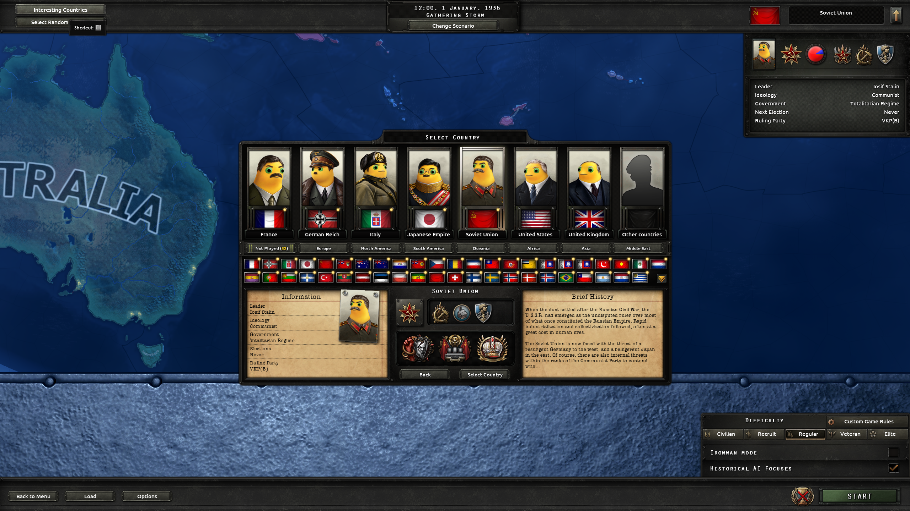

# 钢奶龙心 / Hearts of Nailong

把《钢铁雄心 IV》的人物本体替换为圆滚滚的黄色奶龙，保留每个人原有的服装、发型、胡须、配饰、姿态与取景。

当前版本 **1.0**，适配 HOI4 **1.19.x**。本次构建包含 **5317 个贴图绑定**；已知库存完成 **5239/5485（95.52%，含 4 个非人物例外）**，仍有 246 个已知来源及历史未解析引用待处理。未完成的来源保留游戏原图。

[Steam 创意工坊订阅](https://steamcommunity.com/sharedfiles/filedetails/?id=3830400579) · [GitHub 1.0 安装包](https://github.com/XenoAmess/xenoamess_hoi4_dev/releases/tag/nailong-v1.0)

法国、英国、美国已进行实际界面抽查，法国推进到 1936 年 1 月 4 日。实测版本为 1.19.3.0，范围、截图和机器证据见[实机验收记录](docs/native-resolution-live-qa-2026-10-30.md)。这不代表所有人物、国家、事件和 DLC 组合均已逐项实机遍历。

游戏贴图逐项采用其原版来源的分辨率。完整高清生成 PNG 原件按原始字节保存在 [`assets/generated_fullsize/`](assets/generated_fullsize/)，用于素材追溯；其中也包含历史版本和未通过审图的结果，不能把素材归档数量当作当前合格数量。[高清索引](data/fullsize-files.json)记录 SHA、尺寸和来源关联。

请将游戏与现实区分开来，尊重不同国籍、族群与背景的玩家，反对歧视，珍惜和平。完整中英双语介绍见 [Workshop 文案](docs/workshop-description.bbcode)。

从 GitHub Release 下载 `gangnailongxin.zip`，解压到 HOI4 用户目录的 `mod` 下，并创建外层 `.mod` 文件指向该目录；也可在创意工坊订阅。与替换相同头像的其他模组可能冲突，建议先单独启用。

开发工具、完整提示词与审图记录保存在仓库中；只有构建器生成的 staging 内容进入游戏包。内部 manifest 如实保存当前覆盖和验收状态。

生产、重试、纯 OCR/键鼠与素材归档规则见 [AGENTS.md](AGENTS.md)。
