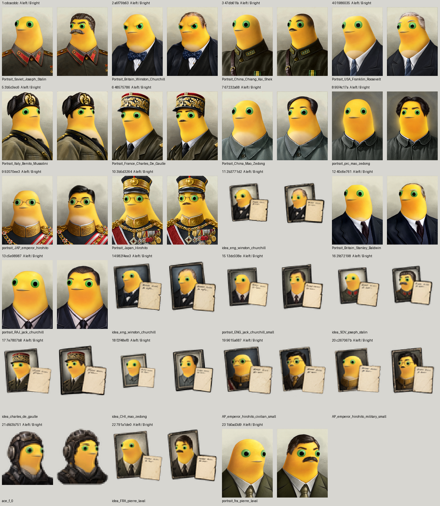
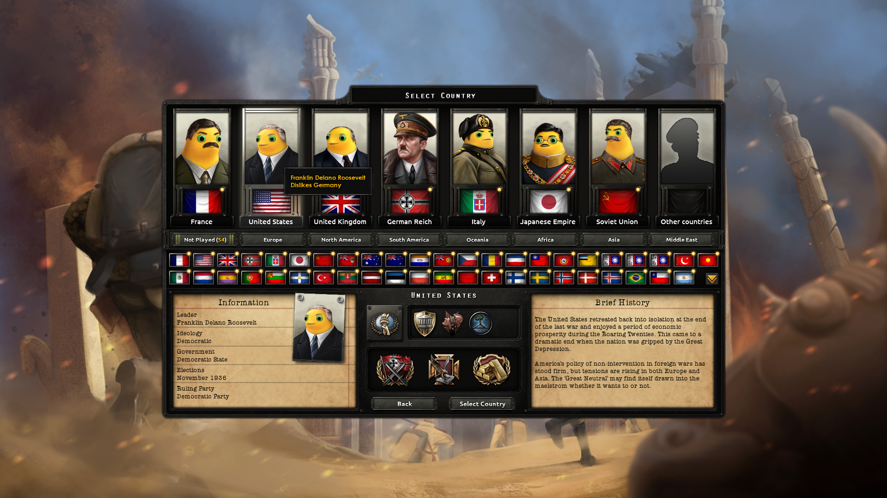
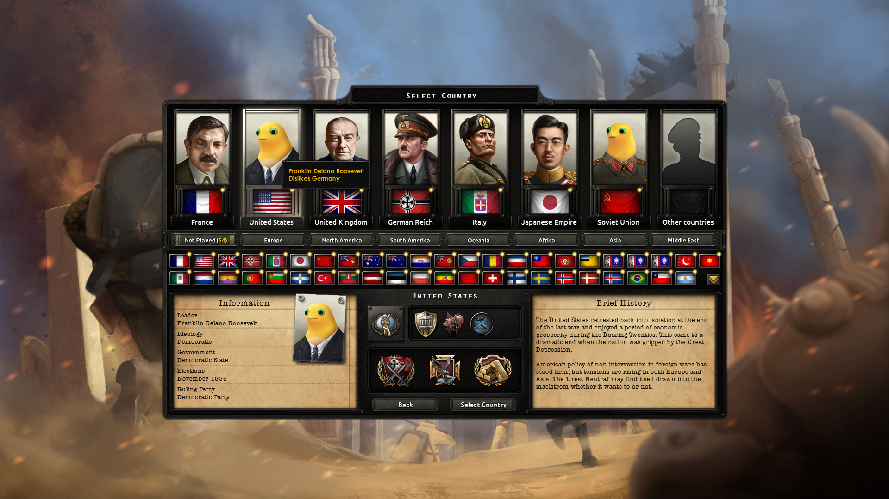

# 钢奶龙心

正式名称遵照用户 2026-10-20 的更正；新构建包为 `gangnailongxin.zip`。目录名和历史回执的兼容边界见[名称说明](docs/product-name.md)。

把 HOI4 人物本体替换为用户参考图中的奶龙，保留原服装、帽子、配饰、姿态、表情和取景，**同时保留原人物可见的发型、胡子、眉毛等附属特征**。用户于 2026-10-16 决定全部旧图和后续图片均采用此版本。目录 `mod_nailong` 遵照用户指定命名，角色外观以实际 ZIP 图片为准。

当前为 **0.1.0-dev 开发预览**，尚未发布到 Steam Workshop。目标包括原版与已安装 DLC 的领袖、将领、顾问大小头像、通用人物、间谍、科学家与王牌飞行员；其他 Workshop 模组与未来游戏更新需重新清点。

游戏贴图默认直接从完整高清母版无损编码，保留全部像素，不预先缩小或模糊。[1081×1455 原始 PNG 样例](docs/media/fullsize-portrait-example.png)也有历史 156×210 审图派生图；小图已不再作为 builder 的默认游戏输入。完整高清 PNG 直接作为普通 Git 文件保存在 [`assets/generated_fullsize/`](assets/generated_fullsize/)，逐图路径、尺寸、SHA 见[索引](data/fullsize-files.json)及[高清母版说明](docs/fullsize-masters.md)。其中包含旧版和未合格输出，素材入库不等于可玩的 mod 已发布。

直接替换高清纹理曾使部分界面按纹理像素放大头像。开发适配通过原版大小的空白布局载体与完整高清纹理分开设置显示尺寸；载体不含缩小人物图。Roosevelt、Halsey 小卡片和 Patton 大头像已在若干实际界面显示正常，适用机器、版本、来源 SHA、截图与未验收范围见[高清显示兼容记录](docs/hd-display-compatibility.md)。这尚不能证明全量兼容，目前没有批准任何降采样例外。

最新本地包为 preview-009：271 个已审图纹理覆盖，来自当时 268 张合格不同原图；`machine_id: bf-202609141645-5434332d4d` 于 2026-10-17 00:28 UTC 前后构建、00:34 UTC 完成用户目录注册与读回。该包尚未做实机加载检查，具体构建、文件 SHA 和边界见[部署回执](docs/preview-009-deployment.json)。下方 preview-007 截图只证明旧包当次的局部显示。

上图为 `machine_id: bf-202609141645-5434332d4d`，2026-10-16 18:42 UTC（北京时间 10 月 17 日）的 preview-007 实机画面。已确认新版罗斯福在国家选择页及信息卡显示，毛发与领口修订可见；这是局部渲染检查，不代表全量头像或全部 DLC 组合已验收。Steam 全程离线，游戏已通过主菜单正常退出；完整绑定见[本轮实机回执](docs/collar-preview-007-runtime.json)。

上图来自 `machine_id: bf-202609141645-5434332d4d`，2026-10-16 02:38 UTC，HOI4 1.19.3.0，首次四头像开发包，使用此前不保留毛发的 A 版。完整来源、原图 SHA 和适用范围见[会话回执](docs/session-2026-10-16.json)。这张历史图不能证明新版或其他图片实机通过。

当前采用的毛发特征规则与迁移说明见[毛发版本生产记录](docs/hair-features-production.md)。原 26 个资源实例的对照实验在 [experiments/hair-features-v1/](experiments/hair-features-v1/)，冻结了 23 张不同原图对应的旧图和完整旧 prompt。所有新生成及返修在请求前保存完整实际 prompt，成功、失败和被弃用的尝试均留记录。跨模型对照、局部修缮与 Alpha 验收的可复用流程见[头像生成、局部修缮与 Alpha 验收方法论](docs/portrait-generation-and-repair-methodology.md)。

用户追加了[粗脖子与衣领衔接检查](docs/collar-fit-production.md)：既有 106 张完成专项复查，发现的 28 张问题图均已重新生成并通过对照审查，后续同样采用紧凑头颈与适配领围。合格数量以当前图片 SHA 对应的毛发与领口双重审图为准，历史进度不抵扣新要求。

小卡片另做[原图细节复查](docs/source-feature-review.md)：对照实际同版大头像辨认眼镜、胡须和敞领/闭领服装，确认误增或遗漏后撤销旧图资格并逐张返修。奶龙本来的灰色嘴部不能算作保留了人物胡子；有胡须时须在嘴部上方另有可辨认的毛发。不同服装版本仍独立生成，不按姓名或相近文件名合并。

## 生产流程

历史、具名和架空的重要人物统一为高优先级，当前共 4,535 张；高组全部完成才开始其余 703 张。2026-10-17 修复路径归一化找回 95 张小头像后，又补回 14 张未绑定角色的独立小头像，总量更正为 5,238 张；依据见[路径更正](docs/catalog-path-normalization.md)与[独立卡片补漏](docs/catalog-unbound-portrait-cards.md)。内部顺序、角色分类及去重口径见[生产优先级](docs/production-priority.md)。队列已锁定此顺序，图片采用内置工具单路连续生成。

1. `python mod_nailong/tools/catalog.py scan`：从实际安装读取原版/DLC 文件、角色定义和 sprite 引用，记录源 SHA 与机器/版本。不会复制完整游戏资产到仓库。
2. `python mod_nailong/tools/catalog.py prepare --limit 16`：准备尚未完成的原图与输入 contact sheet；完全相同的原始字节共用生成，其他变体独立生成。
3. 用 imagegen skill 检查原图，逐张引用原图与 `assets/reference/naiwa.png`，保留原人物毛发特征。请求前保存完整实际 prompt；基础提示词在 [portrait-prompt.txt](assets/portrait-prompt.txt)，实际调用词另行逐次落盘。不可用程序贴头、统一通用头像或滤镜冒充。
4. 调用前用 `generation_requests.py prepare --key <原图SHA256> --prompt-file <实际提示词.txt>` 固定完整 prompt 与输入；调用后用 `generation_requests.py finish --key <原图SHA256> --image <生成文件.png>` 导入。修改旧图加 `--edit-existing`。导入保存修订、输入和输出 SHA；原始高清 PNG 按原字节保存进工作树，另生成原版尺寸的审图/历史派生图，游戏 builder 读取高清原件。交付前用 `master_archive.py sync-git` 补齐全部历史及新输出的索引，再将 PNG 实际文件提交、推送到 Git；核验方法见[高清母版说明](docs/fullsize-masters.md)。已返回图片的本地导入中断按[严格恢复机制](docs/interrupted-import-recovery.md)续接，不能因此重复生成。对照实验使用其专用 recorder，同样在调用前落盘。
5. 审图与下一张生成重叠，使用 `review_pairs.py` 对照原图与当前图，核对毛发、服装、神态和领口；`production_queue.py review` 只排队 SHA / attempt 绑定的人工决定，由同一生成执行者在导入之间 `apply-reviews`。不并发改写共享 manifest，未看图不得批准；见[滚动队列及实测](docs/rolling-production-queue.md)。
6. `python mod_nailong/tools/portraits.py coverage`：读回生成/审图数量。
7. `python mod_nailong/tools/build_release.py --preview --check --validation-sample 4`：对明确标注的四个高清样本双构建，逐文件核对 ZIP、DDS 解码与母版分辨率；这不是整库构建验收。`--preview --source-key <原图SHA> --output <全新目录>` 可生成少量高清实机验证包。完整高清导出前执行共享存储预算；正式构建不带 `--preview`，覆盖不足、未审图或缺失引用仍会拒绝。

构建按原版虚拟纹理路径覆盖，只包含已生成并审查的图片、经登记的4个非人物原图例外和 descriptor。例外按 `runtime/source-index.json` 的真实原版文件及 catalog SHA 保留原始字节，不伪造生成行，也不重编码或缩放。不覆盖人物属性、国家历史或全局目录，不使用 `replace_path`。按 2026-10-18 最新要求，游戏 DDS 直接从高清母版流式编码，保留完整分辨率和透明度，不再先缩回原版尺寸。高清在各界面的布局兼容须实际验证，只有证明确实必须缩放的个别项才允许例外；现有小图保留作审图预览和历史派生。

共享虚拟路径的多个 DLC 变体全部保留在库存；当前 builder 默认按 DLC 数字 ID 选择本机全部已安装内容的候选，`--packages` 可冻结指定 DLC 列表（空列表表示仅原版）。这一顺序仍须对照目标启用 DLC 的实机验证，不能据静态规则声称任意 DLC 组合已通过。

## 当前边界

- 完整库存含数千张原图，逐张生成尚未完成；没有用通用奶蛙图填满空位。
- 当前数量以[进度快照](data/progress.json)为准；`textures_reviewed` 仅计符合当前毛发与领口规则且已审图的资源。旧 23 张/26 资源统计是 A 版历史基线，不能抵扣新版迁移；全量目标现为 5,238 张不同原图。棺木状态标记与扑克牌占位图经原图审查确认不含人物，已在 catalog 中显式注明排除。
- 原版角色定义中存在本机未找到 sprite 定义的引用，见 `data/catalog.json` 的 `unresolved_references`；仍需分辨上游缺口、条件加载和扫描范围。不得隐藏它们以形成 100% 完成结论。
- [原版引用分析](data/baseline-reference-analysis.json)当前保留 748 次未解析引用、709 个不同值：694 个名字未在当前扫描集合中找到，15 个 sprite 的目标纹理仍未解析。原先 899 次记录中有 151 次由扫描器双斜杠处理错误导致，已更正；剩余项仍可能涉及解析范围或引擎规则，不能据此断言原版损坏或已知 fallback。原定义 SHA 已固定，没有改动原版人物定义。
- [未解析引用复查](docs/remaining-reference-investigation.md)记录本机精确名字与相近文件路径的检查；相近文件不自动视作别名，不据此减少缺失数。
- 图像服务的真实拒绝及原请求 ID、prompt、输入保存在[失败记录](data/generation-failures.json)；冷却截止与累计重试消耗见[重试队列](data/image-retry-queue.json)。按 2026-10-18 最新用户指令，每次拒绝后至少冷却 8 小时，允许的原请求以相同提示词、输入和内置工具重试；成功即停止，每张原图累计最多重试 8 次（含首次调用最多 9 次），此前次数不清零。美术审图不合格另记，不与服务拒绝混合。规则与统计口径见[重试政策](docs/image-retry-policy.md)。
- `prepare` 自动跳过被拒来源及同虚拟路径变体；人工准备时也暂缓已识别的同人物其他变体，继续其他素材。跳过项仍计入未完成分母。
- UI 奶蛙化为低优先级奖励，尚未交付。
- 提示词与生成审图记录见 [generated.json](data/generated.json)；构建通过不等于游戏实机通过。

机器与首批来源见 [开发记录](docs/development-2026-10-16.md)。

内置图片工具已做 1/4/8 路真实头像测试，结果及可证明的边界见[并发实测](docs/builtin-image-concurrency.md)。同时挂起请求不等于并行生成，实际吞吐与审图合格率分别记录。
