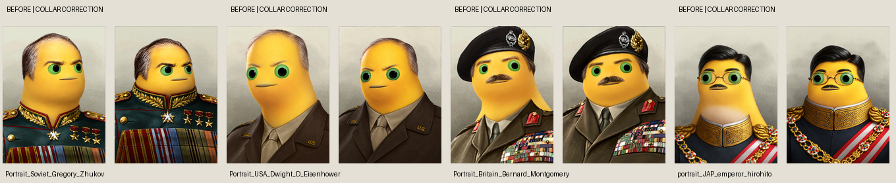

# 奶龙体型与原衣领的衔接修正

用户于 2026-10-17（Asia/Shanghai）要求额外检查部分人物的衣领与奶龙粗脖子不协调，修改提示词并重新生成问题图片。继续保留原人物的头发、胡子等特征，继续只用内置图片工具、单路生产，高优先级全部完成后才制作非高组。

对当时 106 张 canonical 图与各自原图完成了九页逐图对照，标出 28 张存在长柱形黄脖子、领围过窄、颈部与布料遮挡不自然或奶白肚皮误画到领口等问题。其余 78 张通过领口专项检查；这不撤销原有的错胡子、漏眼镜等其他拒绝状态。完整基线 SHA、判断、来源与机器身份在 [collar-fit-audit.json](../data/collar-fit-audit.json)。原图对照页只保存在本机 runtime，不把整批游戏原图上传公共仓库。

新版 prompt 要求紧凑圆头贴近宽肩、短而宽的颈部过渡，并按实际颈部底面重新调整原衣服的领围与肩线。保留原衣服设计、材质、领章、饰边、徽章、围巾、领带和扣合状态：原本扣紧的立领仍扣紧，不能用深 V 领代替闭合领口。前领布料遮挡颈部下沿，后领位于颈后，具有接触阴影和正确接缝；奶白肚皮应在衣服下面。

新生成基础 prompt 在 [portrait-prompt.txt](../assets/portrait-prompt.txt)，旧图专项返修模板在 [collar-fit-edit-prompt.txt](../assets/collar-fit-edit-prompt.txt)。每个实际请求的完整文本仍在调用前独立保存，并绑定编辑前图片、原图与用户角色参考图 SHA，不只保存此模板。

首轮四张试稿中，艾森豪威尔、蒙哥马利和裕仁已通过新领口检查；朱可夫的试稿虽缩短颈部，却把闭合立领变成了 V 形开口，已拒绝并将扣合条件写入新 prompt。其余 25 张问题图随后进入单路返修队列，生成返回后仍须逐图审查，不能因为服务成功就计作修好。

`tools/art_contract.py` 统一构建、覆盖率和优先级门禁：头像必须保留毛发版本、总审图 approved，且 `collar-fit-v1` 专项审查的图片 SHA 与当前 canonical 完全相同，才算完成。旧审图、旧 collar SHA 或未经领口检查的图片不会进入新 staging，也不能解锁非高优先级。`portraits.py approve` 在实际审图后记录此项，生成新修订会清除旧专项资格。

专项复审导致合格数量暂时回退是正常的：2026-10-16 16:15 UTC，`machine_id: bf-202609141645-5434332d4d` 的读回为全量 77/5,129、高优先级 60/4,426；这是仍需返修时的中间状态，不代表删减库存。旧 preview-006 曾含 102 张毛发规则已审图素材（106 个纹理覆盖），没有完成新领口要求，不能作为当前美术验收通过包。之后应由新版 builder 重新构建并部署。

2026-10-16 17:58 UTC（北京时间 10 月 17 日），同一机器完成剩余 25 张逐图对照并批准。此次专项共 29 次内置工具调用，全部返回图片；朱可夫第一次试稿美术拒绝，最终 28 张问题来源均已有合格修订。完整旧/新图片 SHA、请求记录与当前专项资格见 [correction-review](../data/collar-fit-correction-review.json)。基线审查与被弃用试稿仍保留原状。

修正后当前合格为 102/5,129（1.99%），其中高优先级 85/4,426（1.92%），余下高优先级 4,341 张。对应 107 个资源实例；这只代表离线美术审查，不证明当前新版已完成游戏实机验收。早期快照的统计按当时构建选择保留，当前数字以重新计算的 [progress.json](../data/progress.json) 为准。

随后在同一机器完成 preview-007 局部实机渲染检查，18:42 UTC 截图确认领口修正后的罗斯福实际显示在国家选择页和信息卡；其余未观察位置仍未验收。Steam 前后均人工看图确认离线，游戏正常退出且进程读回已消失。截图和具体边界见 [runtime receipt](collar-preview-007-runtime.json)。

后续重要人物第二批的 26 个初始请求返回 24 张图片、2 次服务拒绝。逐图对照先通过 14 张，另 10 张因擅加胡子或漏掉稀疏侧发返修；10 次返修中返回 9 张并通过复审、1 次被拒。该批净新增 23 张合格来源。小头像同样需明确记录有无胡子、秃顶与侧发、眼镜等，而非让模型从低像素噪点推测；服务拒绝与美术不合格分别保留。

2026-10-16 21:09 UTC，同一机器继续完成第三、第四批复审。第三批经三次专项返修后净计 22 张合格来源；第四批 21 个请求中 13 张返回并全部通过与原图的逐张对照，包含五人会议图的全尺寸检查。第四批另 8 次服务拒绝不计完成。累计当前合格为 167/5,224，高优先级 150/4,521；本轮库存分母更正见[路径归一化说明](catalog-path-normalization.md)，实时数量以进度快照为准。各次实际 prompt、图片 SHA 和失败状态保留在逐来源 journal，批次回执在 `data/production-batches/`。

第二轮冷却共原样重试六次：五次再次拒绝；一张返回图因长颈与奶白领口不合格，其后针对已接受图片的领口返修也被拒。六个来源均仍未完成，且每来源唯一自动重试已消耗，不能通过增加变体请求或重写提示词继续重试。其他尚未尝试的重要人物继续生产。
